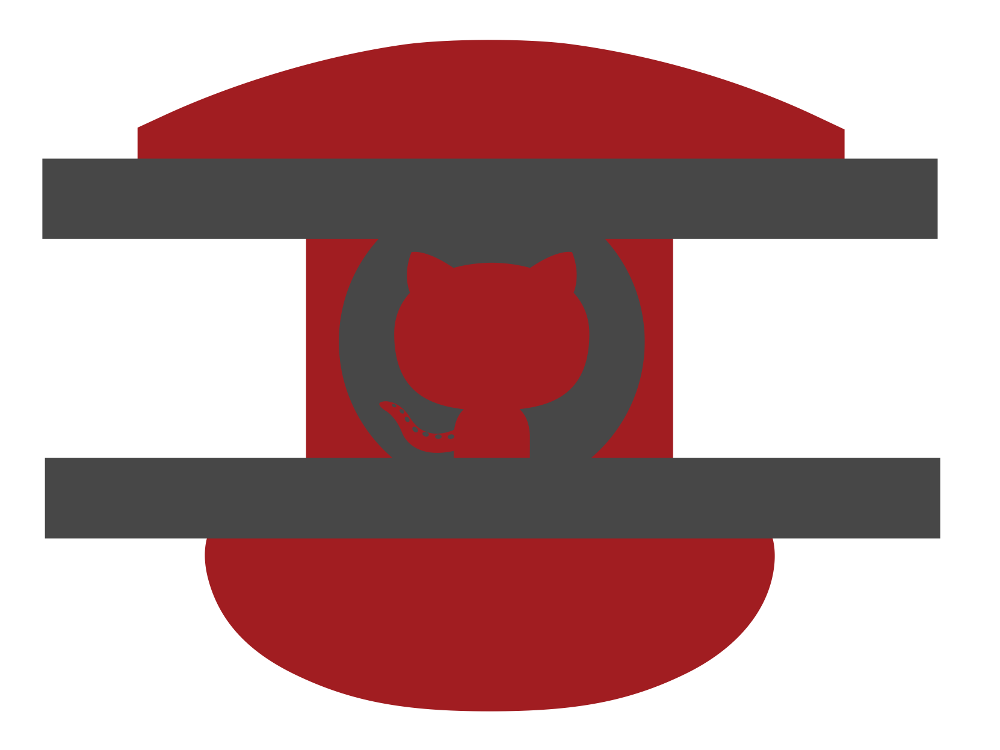

.. raw:: html

   

Home
=================

.. raw:: html

   

.. figure::  _static/img/rivt-finalb.png
   :class: dark-light
   :scale: 20%
   :align: center
   :alt: rivt logo
   

.. raw:: html

   

    
.. |rivt_logo| image:: _static/img/rivt-finalb.png
   :width: 70px

.. |studio_logo| image:: _static/img/rvstudio2.jpg
   :width: 70px

.. |remote_logo| image:: _static/img/rvremote.png
   :width: 70px

.. |open_logo| image:: _static/img/openmod2.png
   :width: 70px

*rivt* is an open source Python project for writing and sharing engineering
documents and their sources. It includes both a portable desktop editor 
and a containerized server application that runs in the browser. The
:ref:`motivation <rvmotivation>` for writing *rivt* is in the benefits
that come from freely sharing live engineering documents that can be 
edited, automated and checked.

.. raw:: html

    

.. table:: 
   :class: v-align-middle
      
   +---------------+-----------------------------------------------------------------------------------+
   | |rivt_logo|   | `rivtlib`_ - a Python library for processing *rivt markup* ( `source`_ )          |
   +---------------+-----------------------------------------------------------------------------------+
   | |studio_logo| | `rivtStudio`_ - a portable writing and publishing application on the desktop      |
   +---------------+-----------------------------------------------------------------------------------+
   | |remote_logo| | `rivtRemote`_ - containerized *rivtStudio* for servers and browsers               |
   +---------------+-----------------------------------------------------------------------------------+
   |  |git_logo|   |  :ref:`GitHub search <search-interface>` - find public *rivt* projects on GitHub  |
   +---------------+-----------------------------------------------------------------------------------+
   |  |open_logo|  | `openModels`_ - online database of shared models and documents including *rivt*   |
   +---------------+-----------------------------------------------------------------------------------+

.. _openModels: https://openmodels.info
.. _rivtStudio: https://github.com/rivt-info/rivtStudio
.. _rivtRemote: https://github.com/rivtlib-dev/rivtStudio-devcontainer-1.0.0a20
.. _rivtlib: https://pypi.org/project/rivtlib

.. _source: https://github.com/rivtlib-dev/rivtlib

*rivtlib* and *rivtStudio* are distributed under the 
`MIT open source license <https://opensource.org/license/mit>`_ 
( see :ref:`FAQ <Licenses>` ). Email for 
:email:`questions and comments. <openmodels.info@gmail.com>`

.. raw:: html

   

   
ver: 1.0.0a20 
    - Note: rivt is currently <i>alpha sofware</i>. Some features are 
   incomplete and the program structure and markup may change.

.. toctree::
   :maxdepth: 1
   :hidden:

   rvA01-overview.rst
   rvB01-rivtfile.rst
   rvC01-publish.rst
   rvD01-rivtstudio.rst
   rvE01-aiwork.rst
   rvF01-quickref.rst