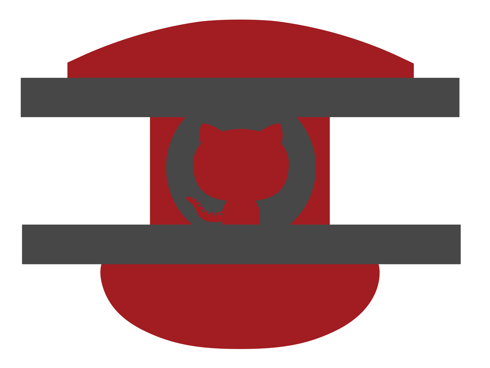

.. raw:: html

   

Home
=================

.. raw:: html

   

   

.. raw:: html

   

.. |spaces| unicode:: U+00A0 U+00A0 U+00A0
.. |space2| unicode:: U+00A0 U+00A0 U+00A0 U+00A0 U+00A0
.. |space4| unicode:: U+00A0 U+00A0 U+00A0 U+00A0 U+00A0 U+00A0 U+00A0 U+00A0
.. |space8| unicode:: U+00A0 U+00A0 U+00A0 U+00A0 U+00A0 U+00A0 U+00A0 U+00A0 U+00A0 U+00A0 U+00A0 U+00A0

   

*rivt* is an open source `Python <https://www.python.org/>`_ and integrated IDE
(Integrated Development Environment) for writing and sharing live engineering
documents and their sources. Python knowledge isn't necessary, but knowing or
learning it can increase *rivt* capabilities. There are several parts to
the project. They are all distributed under the 
`MIT open source license <https://opensource.org/license/mit>`_ 
( :ref:`FAQ <Licenses>` ). 

.. table:: 
   :class: v-align-middle
      
   +------------------------------------------------------------------------------------------------------------------------+
   | |rivt_logo| |spaces| `rivtlib`_ is a library for processing *rivt* Python files ( `rivtlib source`_ )                  |
   +------------------------------------------------------------------------------------------------------------------------+

.. table:: 
   :class: v-align-middle
      
   +----------------------------------------------------------------------------------------------------------------------------------------------------------------------------------+
   | |studio_logo| |spaces| `rivtStudio`_  is a portable desktop editor for writing and publishing *rivt* documents ( `rivtStudio source`_ ). It can be paired with different IDEs.   |
   +----------------------------------------------------------------------------------------------------------------------------------------------------------------------------------+

- *rivtStudio-Codium* uses `VSCodium <https://vscodium.com/>`_. 
- *rivtStudio-Pyzo* uses `Pyzo <https://pyzo.org/>`_. 

.. table:: 
   :class: v-align-middle
      
   +------------------------------------------------------------------------------------------------------------------------+
   | |remote_logo| |spaces| `rivtRemote`_ is *rivtStudio* running in a browser  ( `rivtRemote source`_ )                    |
   +------------------------------------------------------------------------------------------------------------------------+

.. _rivtlib source: https://pypi.org/project/rivtlib/
.. _rivtStudio source: https://github.com/rivt-info/rivtStudio
.. _rivtRemote source: https://github.com/rivtlib-dev/rivtStudio-devcontainer-1.0.0a20

.. _rivtlib: https://pypi.org/project/rivtlib
.. _rivtStudio: https://github.com/rivt-info/rivtStudio/releases/latest
.. _rivtRemote: https://pypi.org/project/rivtlib

*rivt* documents are generated from files and folders designed for open source
sharing through public repositories like *GitHub* that provide version control
and user interaction, or cloud databases like *Google Drive* that are simple to
access and do not require an account. The table below provides a summary:

**rivt Files and Folders**

.. table:: 
   :class: v-align-middle
        
   +------------------------------------------------------------------------------------------------------------------------+
   | |space2| **rivt-project_folder_name** - The enclosing folder for a *rivt* project                                      |
   +------------------------------------------------------------------------------------------------------------------------+
   | |space4| **rvreport-report_folder_name** - The enclosing folder for a *rivt* report                                    |
   |                                                                                                                        |    
   | |space4| **rvhandbk-handbook_folder_name** - The enclosing folder for a *rivt* handbook                                |
   +------------------------------------------------------------------------------------------------------------------------+
   | |space8| **rvDDSS-file_name.py** - A file that generates a *rivt* doc - the basic unit of a *rivt* document report     |
   |                                                                                                                        |    
   | |space8| **rvscript-file_name.py** - A Pyhon file that extends *rivt* functionality                                    |
   |                                                                                                                        |    
   | |space8| **rvtask-file_name.shelltype** - A shell file that runs external programs                                     |
   +------------------------------------------------------------------------------------------------------------------------+
 
.. _openModels: https://openmodels.engineering

   +------------------------------------------------------------------------------------------------------------------------+
   | |git_logo| |spaces| :ref:`GitHub search <search-interface>` - find public *rivt* files on GitHub                       |
   |                                                                                                                        |
   | |open_logo| |spaces| `openModels`_ - online database of shared model and document files ( including *rivt* )           |
   +------------------------------------------------------------------------------------------------------------------------+

Examples of *rivt files* and *docs* include this 
user manual, which was written in *rivt*, and other :ref:`demo files <rivt-tutor>`.

*rivt* was developed because there are :ref:`many benefits <rvmotivation>` to
writing and freely sharing live, editable engineering documents. For questions and 
comments please send emails to questions@openmodels.engineering

.. raw:: html

   

   
ver: 1.0.0a20 
    - Note: rivt is currently <i>alpha sofware</i>. Some features are 
   incomplete and the program structure and markup may change.

.. toctree::
   :maxdepth: 1
   :hidden:

   rvA01-overview.rst
   rvB01-rivt.rst
   rvC01-publish.rst
   rvD01-rivtstudio.rst
   rvE01-aiwork.rst
   rvF01-quickref.rst