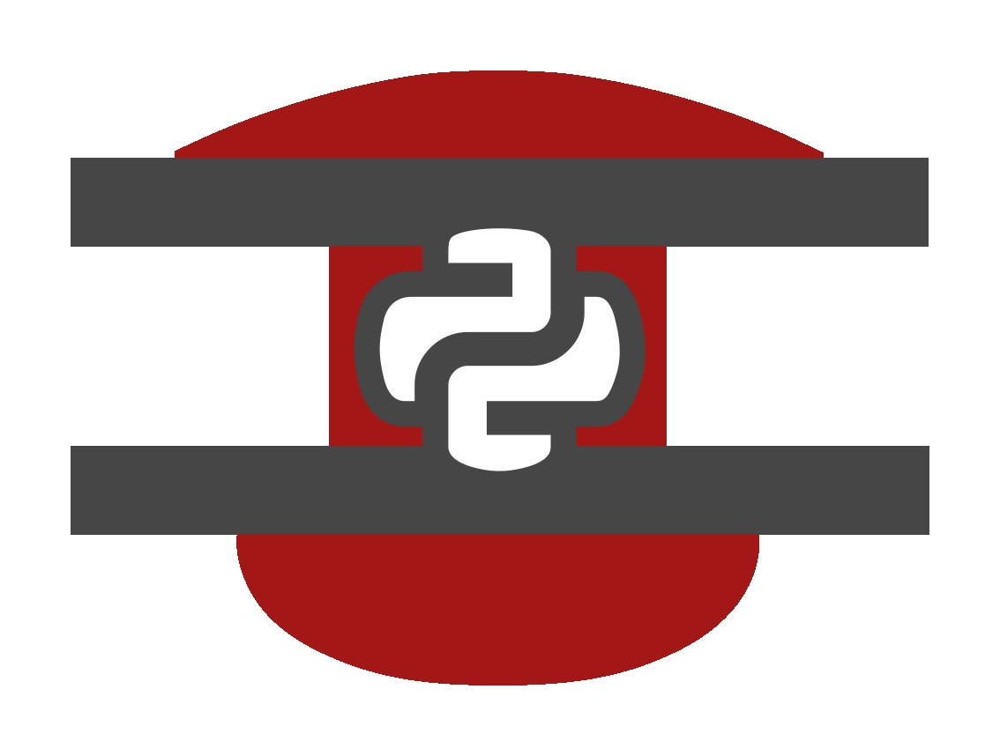
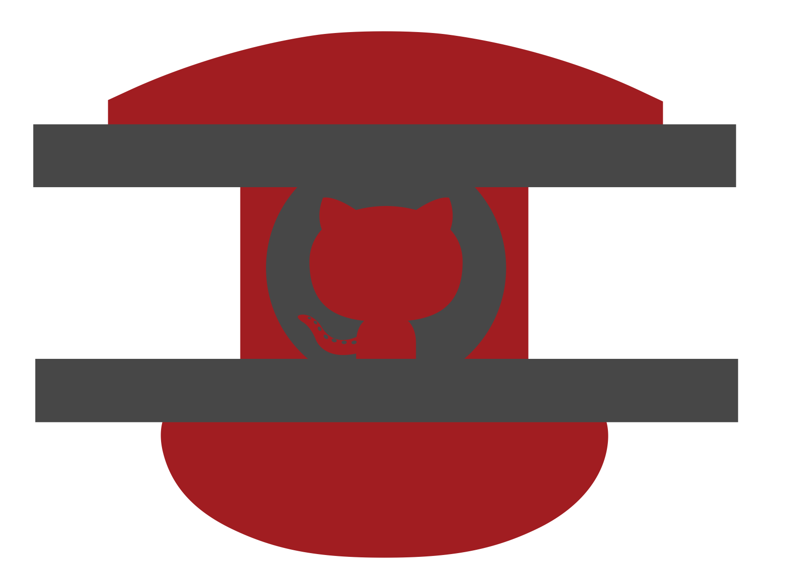

.. raw:: html

   

Home
=================

.. raw:: html

   

   

.. raw:: html

   

.. |spaces| unicode:: U+00A0 U+00A0 U+00A0
.. |space6| unicode:: U+00A0 U+00A0 U+00A0 U+00A0

   

*rivt* is an open source Python project for writing and sharing live engineering
documents and their sources. It includes a portable desktop editor and an
editor that runs on a server in the browser. The table below provides links to 
the installation programs and source code. 

.. table:: 
   :class: v-align-middle
      
   +------------------------------------------------------------------------------------------------------------------------+
   | |rivt_logo| |spaces| `rivtlib`_ - Python library for processing *rivt markup* ( `rivtlib source`_ )                    |
   +------------------------------------------------------------------------------------------------------------------------+
   | |studio_logo| |spaces| `rivtStudio`_ - portable writing and publishing desktop application  ( `rivtStudio source`_ )   |
   +------------------------------------------------------------------------------------------------------------------------+
   | |remote_logo| |spaces| `rivtRemote`_ - containerized *rivtStudio* for servers and browsers  ( `rivtRemote source`_ )   |
   +------------------------------------------------------------------------------------------------------------------------+
   | |space6| |git_logo| |spaces| :ref:`GitHub search <search-interface>` - find public *rivt* files on GitHub              |
   |                                                                                                                        |
   | |space6| |open_logo| |spaces| `openModels`_ - online database of shared model and document files including *rivt*      |
   +------------------------------------------------------------------------------------------------------------------------+
   
.. _rivtlib: https://pypi.org/project/rivtlib
.. _rivtStudio: https://github.com/rivt-info/rivtStudio/releases/latest
.. _rivtRemote: https://pypi.org/project/rivtlib
.. _openModels: https://openmodels.engineering

.. _rivtlib source: https://github.com/rivtlib-dev/rivtlib
.. _rivtStudio source: https://github.com/rivt-info/rivtStudio
.. _rivtRemote source: https://github.com/rivtlib-dev/rivtStudio-devcontainer-1.0.0a20

*rivtlib*, *rivtStudio* and *rivtRemote* are distributed under the 
`MIT open source license <https://opensource.org/license/mit>`_ 
( see :ref:`FAQ <Licenses>` ). 

*rivt* was written  because there are :ref:`many benefits <rvmotivation>` to freely 
writing and sharing live engineering documents. Examples of *rivt files* and *docs* 
are :ref:`here <rivt-tutor>`.  For questions and comments please send 
email to questions@openmodels.engineering

.. raw:: html

   

   
ver: 1.0.0a20 
    - Note: rivt is currently <i>alpha sofware</i>. Some features are 
   incomplete and the program structure and markup may change.

.. toctree::
   :maxdepth: 1
   :hidden:

   rvA01-overview.rst
   rvB01-rivtfile.rst
   rvC01-publish.rst
   rvD01-rivtstudio.rst
   rvE01-aiwork.rst
   rvF01-quickref.rst