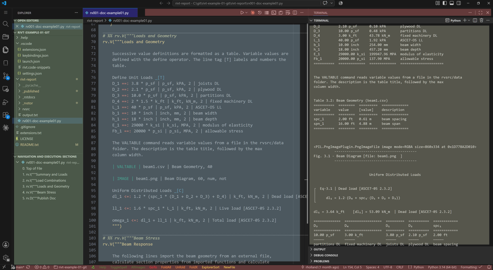
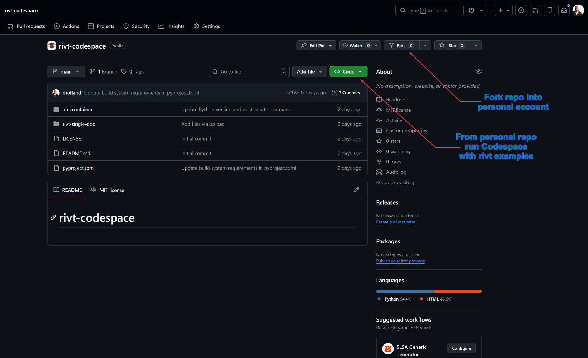

**A.1 |** Start

=====================================================================

.. _rivt-start:

**[1]** Overview
-------------------------------------------------------------------------------- 

*rivt* is an open source project for writing, sharing and reusing engineering
calculation documents [1]_. It runs on the desktop and in the cloud. The project
includes *rivtlib* - a `Python package <https://pypi.org/project/rivtlib/>`_
that formats and compiles *rivt files*, *rivtStudio* - an integrated
desktopeditor that manages and publishes *rivt docs*, and *rivtRemote* -
containerized versions of rivtStudio. Python knowledge is not required to use
*rivt*, but adding custom Python scripts increases its capabilities. 

Each rivt file (.py) uses *rivt markup* to organize text, calculations, images,
code and external programs that may be published as a *rivt doc* (a formatted
text, HTML and PDF document).The *rivt* folder structure provides a replicable
format for organizing a wide variety of file types. Groups of *docs* can form a
complete, structured *rivt report*.

This :ref:`tutorial <rivt-tutor>` provides examples of a 
:ref:`rivt file <example-file>` and :ref:`text <text-doc>`, 
:ref:`PDF <pdf-doc>`, and :ref:`HTML <html-doc>` *docs*. 
 
To get started with running examples see :ref:`install <rivt-start>`. For *rivt
with AI* see :ref:`here <rivt-context>`.

*rivt files and reports* may be shared and distributed through any cloud
storage service. Examples are available on *Google Drive* at 
`openmodels.info <https://www.openmodels.info>`_.  *rivt reports* and 
*rivt handbooks* are organized in top level :ref:`project folders<rivt-folders>`.
A convenient interface for searching public 
*rivt* READMEs is :ref:`here <search-interface>`. 

.. [1] rivt includes provisions for selectively exporting *rivt file*
    sections to a *public rivt report folder* for open-source distribution.

.. _rvmotivation:
 
**[2]** Motivation
-------------------------------------------------------------------------------- 

Broadly sharing engineering documents has been a challenge because they are
complex and because commercial software objectives do not align with this goal.
They may include text, images, tables, calculations, active models and computer
code. They are also dynamic and are frequently updated and recalculated as
project designs evolve and progress.

The need for reuse of engineering documents is a matter of improving efficiency
and making more time for independent and creative thought. Most engineering
calculations are not fundamentally unique. The basic equations and methods are
shared across many projects. However they are always organized differently and
have different inputs. The commercial market response to this need has been to
develop a number of siloed programs with barriers to sharing and reuse
including:

- incompatible documents across different programs
- costly software updates that are backward incompatible
- software limited to specific platforms
- limited version control
- limited report generation
- limited collaboration

*rivt* produces organized, formatted engineering documents from active
calculation files that can be shared anywhere. The primary use cases for *rivt*
are:

A. producing reusable engineering documents that are easier to write, edit and 
   format than LaTeX, Excel, or Word.

B. producing documents with source files that need to be partitioned into public
   and private parts prior to sharing.

C. Using Python and AI tools to write engineering documents

D. Functioning as a front and back end for external software.

Engineering documents include:

#. internal communications
#. research documentation
#. government permits
#. technical reports
#. funding applications
#. teaching and presentation materials
#. homework

For documents with highly specific format requirements including journal
articles and books and that do not need live recalculation, 
`Quarto <https://quarto.org/>`_ is likely a better fit. For interactive calculation
documents that do not need organized reports or partitioning into private and
public sections, `Jupyter Notebooks <https://jupyter.org/>`_ is likely a better
tool.

Finally, the table below summarizes and compares limitations between specific programs
that *rivt* is designed to complement or replace.

.. rst-class:: center

**Software Comparison (commercial programs in italics)**

============= ============ ========= ======== ========== =========== ========== ========= ============= ===========
Program       Reprt [2]_   Ver [3]_  Txt [4]_  Priv [5]_  Unts [6]_  Comp [7]_  C-P [8]_   Coll [9]_     Pub [10]_
============= ============ ========= ======== ========== =========== ========== ========= ============= ===========
*Matlab*         no           no         no     no        no           no         no        no            yes
*Mathcad*        no           no         no     no        no           no         no        no            no
*Mathematica*    no           no         no     no        no           no         no        no            yes
*Cloud SaaS*    limited       no         no     no        no           no         yes      limited       limited
*Excel*         limited       no         no     no        no           yes        no        yes           yes
Jupyter          no           no         no     no        no           yes        yes       yes           yes
Quarto           yes          yes        no     no        no           no         yes       yes           yes
**rivt**        **yes**     **yes**   **yes**  **yes**    **yes**     **yes**    **yes**   **yes**       **yes**  
============= ============ ========= ======== ========== =========== ========== ========= ============= ===========

.. [2] Report generation.
.. [3] Native Git version control.
.. [4] Plain text input and output files.
.. [5] Integrated syntax control of private/public files.
.. [6] Calculation with dual units.
.. [7] Forward and backward compatibility.
.. [8] Cross-platform support.
.. [9] Collaboration support.
.. [10] Text, PDF, and HTML documents from the same input file.

.. _run-rivt:

**[3]** Run rivt
--------------------------------------------------------------------------------

This section covers three ways to run *rivt*.

#. For most users the best way to get started is to download
   *rivtStudio*  (~1 GB zipped, ~2 GB expanded). 
   For further details see :ref:`here <rivt-studio>`.

#. Running *rivtStudio* in the browser connected to a container in the cloud.
   Further details are :ref:`here <rivt-remote>`.

#. For users familiar with Python, *rivtlib* may be installed at the system level
   using *pip* or  *uv*. Further details are :ref:`here <rivt-sys>`.

*rivt* may be edited in a simple text processor and run from the command line 
but efficient editing and compiling is typically done in an :term:`IDE`. Any IDE 
may be used but *VSCode* with extensions is supported and documented. 
A typical **VSCode IDE** layout for editing a *rivt file* is shown below.

    rivt files and docs in **VSCode** (click on image to enlarge)

.. note::

    The :ref:`rivt file <rivt-files>` is in the center editing panel[blue], the 
    :ref:`text doc <rivt-docs>` output is in the right panel[brown] and the
    *file explorer* is the far left panel [green]. Extension buttoms are
    located on the top and bottom status bars [red]. Text, PDF and HTML output
    files are accessed in the file explorer and displayed within panels.
    Individual *rivt* sections are linked in the navigation panel and in the
    text output for quick naviagation through the file. Panel locations may be
    customized by the user. An example *rivt file* and *doc* are
    :ref:`here <rivt-tutor>`.

-------------------------------

This section covers installation of *rivt* and *rivt doc* examples. They are
source software so you are free to download and modify the program as needed 
(see :ref:`FAQ <Licenses>`). The open source software installation process is
designed to gather and install multiple open source components from
various sources. 

.. _rivt-studio:

**[4]** rivtStudio
-------------------------------------------------------------------------------- 

A *rivt-code* installation is recommended for Windows users interested in trying
*rivt* *rivt-code* is a zip file that includes rivt, Python, VSCode and an
example rivt file. The zipped file size is ~800 MB which unzips to about 2.2
GB. It may be downloaded from the `rivt-code repository
<https://github.com/rivtlib-dev/rivt-code/releases/>`_.  
rivtStudio is currently in alpha

The zip file naming convention is:

.. code-block:: text

    rivtStudio-monthx.year.zip

where x is an a-z character representing mid month releases. 

The zip file contents must be unzipped into a directory with read-write access
- typically the users home folder or a flash drive. After unzipping, click the
*rivt-code* shortcut to open the example rivt file in a rivt VSCode
environment. Click on the triangle in the upper right of the editor to run the
file and output text, pdf or html docs, depending on the | PUBLISH | setting.
See the rivt user manual for details.

Features of *rivt-code* include:

#. simplified, isolated installation
#. package and framework integration
#. installation generally needs to be updated as a whole, not the individual components. 
#. integration with other programs may be more difficult. 

*rivt-code* includes preinstalled VSCode extensions designed to simplify editing 
navigation and running *rivt files*. They are listed in :ref:`vscode settings 
<vscode-settings>` and may explored and modified in the VSCode interface. 

-------------------------------

.. _rivt-remote:

**[5]** rivtRemote
-------------------------------------------------------------------------------- 

For users with a `GitHub <https://github.com>`_ account or limitations
on running local software, the best way to get started is to fork and run
:ref:`rivtRemote <rivt-remote>` in a browser. 

`VSCode <https://code.visualstudio.com/>`_ is a customizable code editor that
can be run locally or in the cloud. The cloud version of *VSCode* is referred
to as a `Codespace <https://github.com/features/codespaces>`_ . A 
:term:`rivt Codespace` is a *VSCode* cloud environment with *rivt* extensions 
for editing and running *rivt files*. 

Codespaces are run in a personal GitHub account. When rivt-codespace is forked
into a personal account and run, an example rivt file is loaded. The example
file may be run and edited in the Codespace and the rivt interface extensions
may be explored.

The first time a rivt-codespace is run, it may take a few minutes to load and
initialize the environment. After it is set up, it will load in a few seconds.
The same delays apply to running a rivt file. The first time will be a minute
or two to compile the Python files. Subsequent runs will be a few seconds. The
rivt-codespace environment is persistent and will save any changes made to the
example files.

Steps for running rivt-codespace are provided in the README `here
<https://github.com/rivtlib-dev/rivtlib>`_.

-------------------------------

.. _rivt-sys:

**[6]** rivt system
--------------------------------------------------------------------------------

*rivt* may be installed into a system level Python. 

.. topic:: Step 1. Install Python

    Install Python using `Python installers <https://www.python.org/downloads/>`_
    if not already installed. The minimum required version is Python 3.14.

.. topic:: Step 2. install rivtlib and dependencies

    Install *rivtlib* and dependencies using pip

    .. code-block:: bash

        pip install rivtlib
    
A list of the installed dependencies is :ref:`here <rivt-depend>`.

*rivt* may also be installed and isolated environment using the `uv package
manager <https://docs.astral.sh/uv/>`_. The primary advantage of *uv* is the
simplicity of insalling and updating packages while keeping them isolated from
the system Python. 

*rivt-uv* installation is recommended for users with some familiarity with
Python and programming.

.. topic:: Step 1. Install uv

    Different methods for installing *uv* are described
    `here <https://docs.astral.sh/uv/getting-started/installation/#pypi>`_. 

    The recommended method for installing *uv* is from the command line:

    Windows:

    .. code-block:: bash
        
        winget install --id=astral-sh.uv  -e

        or

        powershell -ExecutionPolicy ByPass -c "irm https://astral.sh/uv/install.ps1 | iex 

    macOS and Linux:

    .. code-block:: bash
        
        curl -LsSf https://astral.sh/uv/install.sh | sh

.. topic:: Step 2. Create the rivt environment

    After installing *uv*, the following rivt install scripts
    will install an isolated *rivt environment*  folder named *rivt-start* 
    in the users *Home* directory.

    Windows:  :download:`rivtuv.cmd </_downloads/rivtuv.cmd>` 

    OSX and Linux: :download:`rivtuv.sh </_downloads/rivtuv.sh>`

    The uv environment can be completely removed with the following commands.

    .. code-block:: bash

        uv deactivate
        rmdir /s /q rivt-examples
        uv cache clean
    
.. topic:: Step 3. Download example rivt report folders

    Example folders can be downloaded and unzipped through
    `openmodels.info <https://www.openmodels.info>`_ or directly from  
    `Google Cloud <https://drive.google.com/drive/u/1/folders/1NP04tdp3FRAir0ErvL2hlm3YBaFlLk5V>`_ .

    *rivt* also includes the `Pyzo <https://pyzo.org/>`_ IDE for editing and
    running examples. Pyzo may be configured in the uv environment and
    provides an effective environment for running rivt examples. 
        
---------------------------------

.. toctree::
    :maxdepth: 1
    :hidden:

    rvA02-tutor.rst
    rvA03-exfile.rst
    rvA04-txtdoc.rst
    rvA05-htmldoc.rst
    rvA06-pdfdoc.rst

