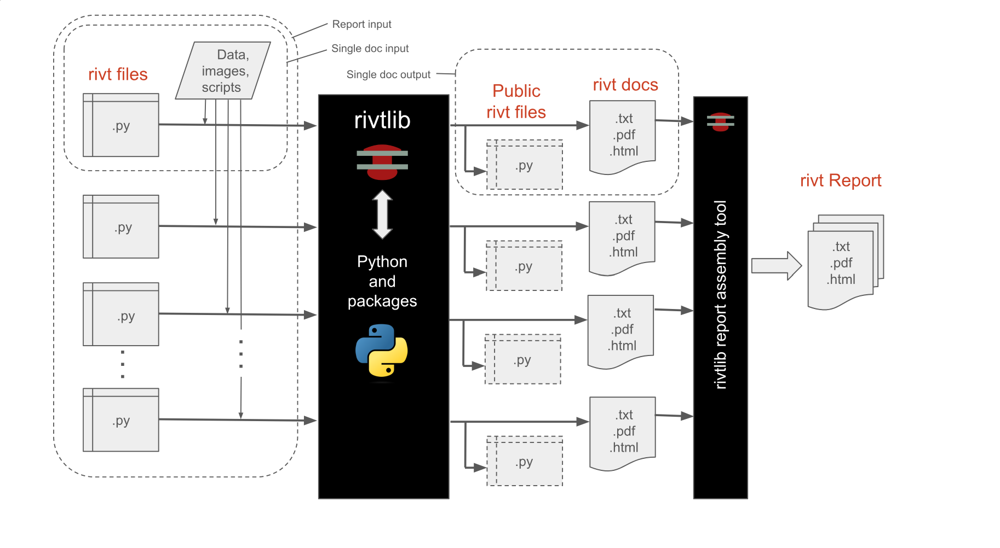

**B.1 |** R-I-V-T
=================================  

.. _rivt-overview:

**[1]** Summary
--------------------------------------------------------------------- 

*rivt* is designed to assemble engineering documents from a wide variety of
sources including engineering programs, data files, Python scripts,
image files and single purpose programs like Excel, Mermaid, Graphviz, and
LaTeX. It accomplishes this using four API functions:

.. raw:: html

    

    <b>R():</b> Processes internal scripts and block text, e.g. Python, LaTeX, rst  

    <b>I():</b> Inserts static sources e.g. images, text, and PDF files  

    <b>V():</b> Imports data and calculates values from equations and functions  

    <b>T(): </b> Runs external binary programs  

A fourth API is documented here:

.. raw:: html

    <b>D(): </b> Publishes documents  

`rivtlib <https://pypi.org/project/rivtlib/>`__ is the Python library that 
compiles a *rivt file* to a text, PDF or HTML doc. A *rivt file* is a 
Python file (.py) that imports the *rivtlib* Python package and includes 
*rivt markup*. *rivt* dependencies are listed `:ref:here <vscode-settings>`. 

A *public rivt file* is a subset of a *rivt file*, made up of sections the
author chooses to share under an `Open Source license
<https://opensource.org/licenses>`__. *rivt* is designed to seamlessly extract
public files, allowing the author discretion in choosing which file 
sections to make public.

Groups of *rivt files* may be compiled and linked into a single 
:ref:`rivt report <rivt-report>`. Collections of *rivt files* with related 
subject matter may be grouped together as a :ref:`rivtbook <rivt-books>`.

*rivt files* are generally edited and run in an IDE. The lightweight 
`Pyzo <https://pyzo.org/>`__ IDE is installed by rivtlib. The 
`VSCode IDE <https://code.visualstudio.com/>`__ is a full featured IDE 
with rivt profiles and extensions documented :ref:`here <vscode-settings>`. 
*VSCode* is installed with the portable :ref:`rivt-code <rivt-code>` installation.

*rivt file* examples are illustrated :ref:`here <rivt-tutor>`. Additional  
*rivt files* may be downloaded from *Google Drive* at 
`OpenModels.info <https://www.openmodels.info/>`__.  An interface for searching 
*public rivt files* on *GitHub* is :ref:`here <search-interface>`. 

*rivt* is distributed under the
`MIT open source license <https://opensource.org/license/mit>`__. 
(see:ref:`Licenses`).

.. _rivt-api:

**[3]** API
------------------------------------------------------------------------------- 

The *rivt API* includes :ref:`API methods <API methods>`, 
:ref:`markup <Line Tags Summary>` and structured 
:ref:`folders and files <file-folder>`.

The API is designed to be:

- lightweight
    :term:`rivt markup` wraps :term:`reStructuredText` and uses fewer than
    three dozen tags and commands. *rivt tags* format lines and blocks of text 
    and *commands* read and write files.

- extensible 
    *rivtlib* is written in Python with direct access to the large 
    library of Python packages and functions. Python scripts and external 
    programs can be integrated into a *rivt doc*.

- versatile 
    A *rivt file* produces a text, HTML or PDF *doc* from the same file. 
    Multiple *docs* can be organized into reports. *rivtbooks* provide a 
    convenient way to organize files around a subject matter for insertion into
    reports. *rivt* can be run within a variety of IDEs.

- efficient
    The file and folder settings produce clear, organized documents with 
    default settings. Settings may be customized via *conf.py* and *yaml* files.

The API methods are listed in the table below, where (rS) is a triple quoted 
:term:`rivt string` argument.

================= =============== ==============================================
API Function         Name             Purpose
================= =============== ==============================================
**rv.R** (rS)         Run          Run external programs
**rv.I** (rS)         Insert       Insert static sources 
**rv.V** (rS)         Values       Calculate values
**rv.T** (rS)         Text         Process scripts and text blocks
**rv.D** (rS)         Doc          Publish docs 
**rv.S** (rS)         Skip         Skip section 
**rv.X** ()           Exit         Exit rivt file
================= =============== ==============================================

An API function starts in the first column and takes a triple quoted
:term:`rivt string` argument containing a *header and content substring*.
The first line of the *rivt string* is the header substring, 
followed by a :term:`content substring` indented 4 spaces 
for readability and section folding. See :ref:`here <rivt-header>` for 
*rivt string* details.

.. _API methods:

**[1]** API methods
--------------------------------------------------------------------- 

*rivt* has seven *API methods*. The name *rivt* is an acronym taken from 
four functions that process content. The remaining functions are used for
document generation and debugging.

.. raw:: html

    <b>Content APIs</b>
    <ol style="border: 2px; 
            border-color: #49b2c3; 
            border-style: solid; 
            padding: 2em;
            margin: 2em">
        <li><b>[R]un</b> Runs Python scripts and markup.</li>
        <li><b>[I]nsert</b> Adds static tables, images and equations.</li>
        <li><b>[V]alues</b> Evaluates equations and functions.</li>
        <li><b>[T]ools</b> Executes shell scripts and external programs.</li>
    </ol>

     

    <b>Publish APIs</b>
    <ol style="border: 2px; 
            border-color: #49b2c3; 
            border-style: solid; 
            padding: 2em;
            margin: 2em">
        <li><b>[D]oc</b> specifies the <i>doc</i> type and style.</li>
        <li><b>[S]kip, e[X]it</b> can be used for interactive debugging and comments.</li>
    </ol>

================ =============== ================================================
API Function         Name             Purpose
================ =============== ================================================
**rv.R** (rS)         Run            Run external binary programs
**rv.I** (rS)         Insert         Insert static sources 
**rv.V** (rS)         Values         Calculate values
**rv.T** (rS)         Tools          Process text scripts
**rv.D** (rS)         Doc            Publish docs 
**rv.S,X** (rS)     Skip, Exit       Skip section, exit (comments, debugging)
================ =============== ================================================

There are several settings that a apply to the entire rivt file. 
These are specified in the *comment settings* immediately following the
import statement. Default settings do not need to be specified - only variants. 

.. code-block:: python

    import rivtlib.rvapi as rv

    # rv private = false ; default section parameter changed to public (true)
    # rv no_tag = true ; API type is added to section number (true)
    # rv set_width = true character width of text output (80

If interactive IDEs are used **rv.S** and **rv.X** can be used for debugging
and cell notation can be used for navigation. Note that Ctrl+Alt+C inserts the
navigation cell label (# %%) if the cursor is on the first line of the cell and
the *rivt Profile* is installed in VSCode.

.. code-block:: python

    # %% My Section Label
    rv._("""My Section Label
    
            Content text and rivt markup - indented four spaces.
        ...
        
        """)

------------------------------------------------

.. _rivt-header:

**[2]** rivt string Header
----------------------------------

Individual *API methods* define sections.  Each :doc:`API function <rvA01-start>` 
takes a raw, triple quoted :term:`rivt string` composed of a 
:term:`header substring` on the first line followed by a multi-line 
:term:`content substring`. The *header line* defines section processing 
parameters. The *content substring* includes :term:`rivt markup` and is indented 
four spaces for improved readability and navigation (e.g. section folding). 
*rivt markup* commands and tags will vary depending on the API function.

The :term:`header substring` starts with a *section label*, also used as the
section title, followed by *section parameters* that override default behavior.
All parameters are optional and may be omitted if defaults are acceptable. If any
parameters are specified the vertical bars bracketing the file name are required.  

The *header substring* specifies the section title and other processing
parameters. The first set of parameters modify section processing. The
second parameter provides the option for a template file or script that
is processed in addition to the *content substring* if provided. 

The *API method header* has two general forms: *Default* and *Modified*. The
default form is used when the *header substring* accepts default parameters. It
only requires a section label. The modified form is used when default parameters
need to be modified.

**Header Defaults**

.. code-block:: python

    rv._("""Section Label 

         Content text and rivt markup - indented four spaces.
        
        ...
        
        """)

**Header Modifications**

.. code-block:: python

    rv._("""Section Label | shmpn | type | template or script file

         Content text and rivt markup - indented four spaces. 
         Content may be ommitted if a template file or script 
         is specified.
        
        ...
        
        """)

The first set of parameters in the *header substring* specify handling of the
*content substring*. The second and third parameters specify a type and file or
script that is processed by the API method before processing any *content*.

**Parameters**

Section parameters may be specified in any order or ommitted if defaults are
acceptable. The default parameters are shown in the

- s
  stores the section content in *_rvstored/sect* as a *.rvt file.*

- h
  processes the section but suppresses the *doc* output.
   
- m
  merges the section with the previous section.

- p 
  toggles the public/private status of the section. The rivt file default is
  private unless overridden by a :ref:`comment settings <comment-settings>`

- n 
  Starts a new pdf page.

**File and Type Settings**

The second parameter specifies a template file or script that is processed by
the API method before processing any *content*. The file is read from the
rvsrc/data folder unless a relative path is specified. The file type is
determined by the API method. The type setting for all
API methods, except rv.T, is *rvt*. A *rvt* file type is a section content
string stored as a file. It is written by the **s** parameter.

For the rv.T method the type settings are:

 #. **PYTHON** - run Python script
 #. **python** - insert Python script
 #. **text** - literal text
 #. **rst** - reStructuredText
 #. **html** - HTML markup
 #. **mermaid** - Mermaid diagram (requires mermaid installation)
 #. **latex** - LaTeX (requires LaTeX installation)

.. _rivt-content:

**[3]** rivt String Content
---------------------------------

The :term:`content substring` is indented four spaces for legibility and 
code folding. It includes :doc:`line tags<rvB03-linetags>`, 
:doc:`block tags<rvB04-blocktags>` and  :doc:`commands<rvB05-commands>` 
along with  text.

.. code-block:: python

    rv._("""Section Label  

        Content text indented 4 spaces.
        ...
        
        """)

Content is converted line by line into formatted text and 
`RestructuredText <https://docutils.sourceforge.io/docs/user/rst/quickref.html>`__,
and then further processed into HTML or PDF. If a line does not contain 
a *command*, *tag* or *assignment* it is passed through as is. This allows the 
*Insert* function (rv.I) to include some *restructured text* directly i.e. 
surrounding words with * or ** will format a word as italic or bold.

In addition block tags in the *Tools function* (rv.R) directly supports
processing HTML, LaTeX and reStructuredText scripts.

-------------------------------------------------

.. _markup:

**[3]** Tags and Commands
----------------------------

:doc:`Line Tags <rvB03-linetags>`

    A :term:`line tag` formats a line of text and is denoted with a single
    **_[LETTER]**, placed at or near the end of the line, depending on the tag.

:doc:`Block Tags <rvB04-blocktags>`

    A :term:`block tag` formats a block of text and begins with
    **_[[TAGNAME]]** and terminates with **_[[END]]**.

:doc:`Commands <rvB05-commands>`

    *rivt commands* read and write external files. They typically start in the
    first column with a vertical bar ( | ) followed by the command name, file
    path, and parameters.

    The exceptions are the definition (**==:**), assignment (**<=:**), 
    function (**:=:**) and compare (**<>**) commands that are used to 
    define, assign and compare values.

    .. code-block:: bash  
        
        | COMMAND | relative path | parameters

    File paths are specified relative to the *rivt root folder*. The *rivt
    report* folder structure is described :ref:`here<rivt-folders>`.

    If the path is ommitted the default path for each command is applied. If
    the *singledoc* parameter is set, the *resource files* and *docs* are
    stored in the *rivt root folder*.

Tag and Command syntax for each API type is defined and described 
using the following format:

.. raw:: html

    

    <b>Markup Key 
     
    _[TAG] or | COMMAND |</b> 
     
    Description 
     
    <pre>
        Syntax:
            _[TAG] or | COMMAND | syntax

        Example:
            This is a sentence. _[C]
    </pre> 
    

------------------------------------

**[2]** Docs
-------------------------------------------------------------------------------

.. rst-class:: center

    **rivt Doc Processing**

Each :term:`rivt file` outputs a corresponding :term:`doc` with the format
specified in | PUBLISH | command of the *rv.D()* API. A rivt file number has the
form:

.. code-block:: text

    rvAnn-filename.py

where rvAnn is a required file number prefix with A an alphanumeric character and nn a two
digit non-negative integer. Corresponding rivt docs are output as:

.. code-block:: text

    rvAnn-filename.txt, pdf or html

A *rivt report* is organized using the *file numbers*. The file numbers are
used to organize reports into divisions and subdivisions. Each *rivt file* or
*doc* is a report subdivision. If the *rivt filenames* are:

.. code-block:: bash

    rvA01-filename.py
    rv105-filename.py
    rv212-filename.py  

the corresponding *doc numbers* in a report would be: 

- A.1 (division A, subdivision 1)
- 1.5 (division 1, subdivision 5)
- 2.12 (division 2, subdivision 12)

--------------------------------

.. toctree::
    :maxdepth: 2
    :hidden:

    rvB02-apiscope.rst
    rvB03-linetags.rst
    rvB04-blocktags.rst
    rvB05-commands.rst    
    rvB06-assign.rst    

