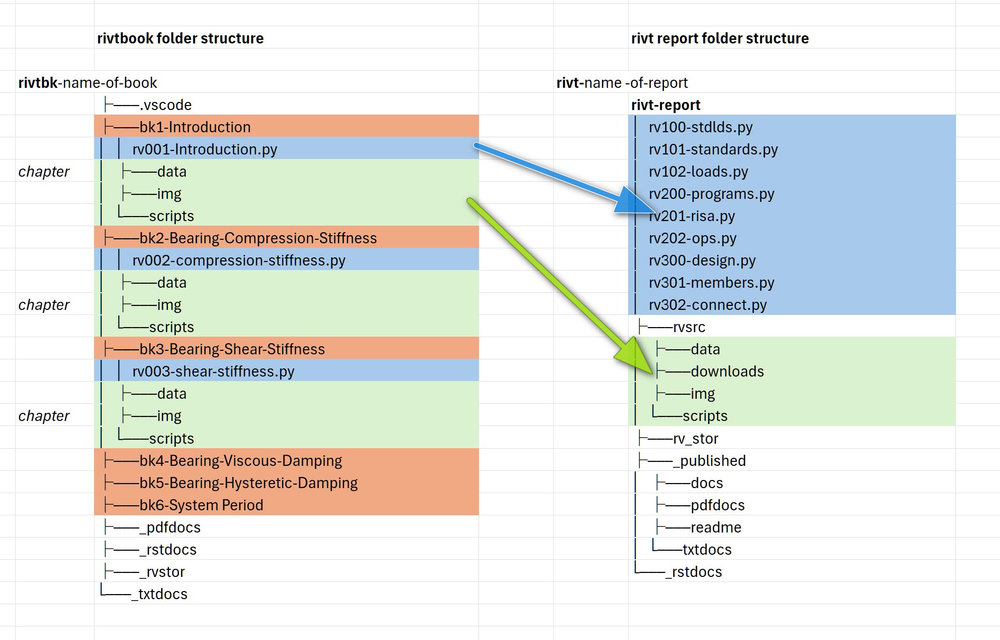

**C.3 |** Folders
===============================================================================

.. _rivt-folders:

**[1]**  rivt Folders
------------------------------------------------------------------------------

**Summary of rivt files and folders**

.. code-block:: text

                        | A rivt file is a Python file file that imports the
   rivt file            | rivtlib Python package and compiles to a text,
                        | PDF or HTML doc.

                        | A file supplied by an author that rivt integrates
   source file          | into a doc - including script, image, data, formulas 
                        | and markup file types.

                        | A rivt project folder contains setting and 
   rivt project folder  | configuration files for the IDE and version control, 
                        | as well as one or more rvbook or rvreport folders.

                        | A rivtbook folder is a collection of rivt files with
   rvbook subfolder     | common subject matter organized to simplify selection
                        | selection of files and resources for inclusion in rivt 

                        | A rivt report folder is a collection of rivt files
   rvreport subfolder   | organized for publication of rivt docs and reports
                        | as text, html or PDF files.

Reports are organized using the folllowing required folders and subfolders:

*containing folder*

*rivt-* project-label   
    
    configuration and environment files for the project

*top-level folders*        
    
    folders include public, report and handbook folders
        
    *_rvpublic-* report-label 
        Includes *public rivt files* designated by the author and written by 
        *rivtlib* for public sharing. The prefix *rvXnn-* is changed to 
        *rv-Xnn-* to avoid confusion with non-public files.

    *rvreport-* report-label 
        Includes files and folders for publishing docs and reports. 

    *rvbook-* handbook-label 
        Includes handbook files and folders. 

*second level folders*
    
    Folders with leading hyphens are written by *rivtlib*. Foldes with internal
    hyphens are written and read by *rivtlib*. Folders with no hyphens are 
    authored by the user.
    
    *rvsrc* 
        Includes author provided source files used by *rivt files* including 
        data, images, run commands, tools and value files.

    *rv_stor*
    Includes output files written by *rivtlib* including *logs*, *values*, 
    *hidden sections* and *metadata* that may be read by other *rivt files*.

    *_published*
        Formatted *docs* and *reports* written by *rivtlib* for publication. 
        Subfolders include *docs* (HTML), *pdfdocs* (PDF) and *txtdocs* (text).

    *_rstdocs*
        Intermediate restructured text files written by *rivtlib*.

  
.. _project-folders:

**[2]** Project Folders
-------------------------------------------------------------------------------

A typical :term:`project folder` structure is shown below. The required *rivt
file* names and prefixes are shown in brackets. 

.. code-block:: bash

    [rivt-]project-Label/             project folder       
        ├── .help/                        help files
        ├── .vscode/                      optional VSCode settings
        ├── .git                          optional git repository
        ├── README.txt                    rivt-generated text report                  
        ├── [_rvpublic-]reptlabel/        rivt-generated public files        
        ├── [rvreport-]reptlabel/         report folder               
            ├── [rivtreport]-1.py            report generating script
            ├── [rv101-]filename1.py          rivt file
            ├── [rv102-]filename2.py          rivt file       
            ├── [rv201-]filename3.py          rivt file          
            ├── [rvsrc]/                      author provided files and folders        
            ├── [_rvstor]/                    rivt-generated source files
            ├── [_published]/                 rivt-published docs and reports
            └── [_rstdocs]/                   rivt-generated rst files
         ├─ [rvhandbk-]booklabel/         handbook folder              
                ├── [_rstdocs]/               rivt-generated rst files
                ├── [_pdfdocs]/               pdf docs and rivtbook report
                ├── [_rvstor]/                rivt-generated source files
                ├── [bk1-]chapter name/       chapter folder                 
                ├── [bk2-]chapter name/       chapter folder 
                └── [bk3-]chapter name        chapter folder

.. _report-folders:

**[3]**  Report Folders
-------------------------------------------------------

A typical :term:`report folder` structure is shown below. The required 
*rivt file* names and prefixes are shown in brackets.  For the
:term:`rivtbook folder` structure see :ref:`here <book-folder>`.

A report folder can contain any file or folder but the following structure is
required for doc processing. *report folders* include at least the folders and
files with prefixesshown in brackets[] below. Folders with an underscore
contain rivt generated files. Files and folders are organized under a rivt root
folder with the prefix *rivt-* followed by the report label, e.g.
rivt-Report-Label.

A new report folder is typically started by copying and editing a
similar folder. rivt-folder examples can be downloaded at 
`Google Drive <https://drive.google.com/drive/folders/1hwVOs0CVJqdZlTieV_Lt5bICbd3ywzWj?dmr=1&ec=wgc-drive-%5Bmodule%5D-goto>`__.

---------------------------------    

.. _book-folder:

**[4]** Handbook Folders
----------------------------------------------------------

A :term:`handbook` collects *rivt files* sharing a common theme under a folder
structure that allows direct copy and paste into *rivt docs* and *reports*. 
Its primary purpose is as an organized collection of files that can be
directly selected and copied/merged as shown in the diagram below.

A *rivtbook* may be printed as a PDF, txt and README.txt file for review and
exploration by using the *rivtbook-report.py* script.

A typical :term:`rivtbook folder` structure is shown below. The required 
*rivt file* names and prefixes are shown in brackets. For the 
:term:`report folder` structure see :ref:`see <rivt-report>`.

.. raw:: html

    

    <b>Folder Naming</b> 
     

    A rivtbook folder can contain any file or folder but the following structure is
    required for <i>rivtbook</i> processing. <i>rivtbook folders</i> include at 
    least the folders and files shown in brackets[] below. Folders with an 
    underscore contain rivt generated files. Files and folders are organized under
    a <i>rivtbk</i> root folder with the prefix <i>rivtbk-</i> followed by the 
    rivtbook label, e.g. <i>rivtbk-Book-Label</i>.    

    A new <i>rivtbook folder</i> is typically started by copying and editing a
    similar folder. Several <i>rivt-folder</i> examples can be downloaded at 
    <a href="https://www.openmodels.info/">openmodels.info</a>.
       

 
*rivtbooks* are organized to simplify selection of *rivt files* for 
inclusion in *rivt docs* and *reports*. Typical use involves the following
steps. To insert a *rivtbook subdivision* into a *rivt doc or report*: 

#. Copy the *rivt file* within a *rivtbook subdivision folder* to the 
   *rivt-report* folder of the target report or doc and edit the 
   *rivt doc number*.

#. Within the same *subdivision folder* copy all resource files and folders and 
   paste (merge) them into the *rvsrc* folder of the target report or doc. A 
   single copy and paste command will merge all of the required files.

#. The *subdivision* from the book is now inserted as a *subdivision* in the 
   report, where further edits can be made.

-----------------------------------------

.. _complete-folders:

**[5]** Complete Structure
---------------------------------------------------------------------

.. code-block:: bash

    [rivt-]project-Label/             project folder       
        ├── .help/                        help files
        ├── .vscode/                      optional VSCode settings
        ├── .git                          optional git repository
        ├── README.txt                    rivt-generated text report                  
        ├── [_rvpublic-reptname]/         rivt-generated public files
            ├── rvsrc/                        author source files          
            ├── rv-101-filename1.py           public rivt file
            ├── rv-102-filename2.py           public rivt file       
            ├── rv-201-filename3.py           public rivt file          
             ...
        ├── [rvreport-reptname]/          report folder               
            ├── [rivt-report]-1.py            report generating script
            ├── [rv101-]filename1.py          rivt file
            ├── [rv102-]filename2.py          rivt file       
            ├── [rv201-]filename3.py          rivt file          
                ...
            ├── [rvsrc]/                      author provided files and folders        
                ├── [data]/                         tables    
                    └── steel-vals.csv    
                ├── [downloads]/                    files to download      
                    └── conc-vals.txt 
                ├── [img]/                          images              
                    ├── favicon.png    
                    ├── covlogo1.png    
                    ├── runlogo1.png
                    ├── fig1.png
                    └── fig2.jpg                   
                ├── [scripts]/                      scripts
                    ├── beam1.py    
                    └── text.rst                                                                
                ├── tools/                          OS shell commands               
                    └── opensees.sh                                          
            ├── [_rvstor]/                   rivt-generated source files
                ├── [logs]/                          log files
                    ├── rv101-log.txt
                    └── rv102-log.txt
                ├── [sect]/                          sections not printed                    
                    ├── rv202-5d.txt  
                    ├── rv103-4t.txt                         
                    └── rv301-2r.txt               
                ├── [temp]/                          temp files
                    └── rv101-label3.tex
                ├── output.dat
                ├── v101-2.csv
                └── v102-3.csv         
            ├── [_published]/               rivt-published docs and reports
                ├── [docs]/                          html docs
                    ├── html auxiliary folders    
                    ├── index.html
                    ├── rv101-filename1.html      
                    ├── rv102-filename2.html                      
                    ├── rv201-filename3.html                        
                        ...     
                ├── [pdfdocs]/                       pdf docs
                    ├── pdf auxiliary folders     
                    ├── report-title.pdf
                    ├── rv101-filename1.pdf             
                    ├── rv102-filename1.pdf             
                    ├── rv201-filename3.pdf 
                        ...  
                └── [txtdocs]/                       text docs
                    ├── report-title.txt
                    ├── rv101-filename1.txt              
                    ├── rv102-filename1.txt             
                    ├── rv201-filename3.txt 
                        ...
            └── [_rstdocs]/                    rivt-generated rst files
                ├── _downloads/                    
                ├── _static/                                                       
                ├── rv101-filename1.rst            
                ├── rv102-filename2.rst                          
                ├── rv201-filename3.rst          
                    ...
        ├── [rvhandbk-]book-Label/             rivt handbook folder              
            ├── [_rstdocs]/                        rivt-generated rst files
                ├── _downloads/                    
                ├── _static/                                                       
                ├── rv101-filename1.rst            
                ├── rv102-filename2.rst                          
                ├── rv201-filename3.rst          
                  ...
            ├── [_txtdocs]/                        txt docs and handbook report
                ├── pdf auxiliary folders     
                ├── report-title.txt
                ├── rv101-filename1.txt             
                ├── rv102-filename1.txt             
                ├── rv201-filename3.txt
                  ...        
            ├── [_pdfdocs]/                        pdf docs and handbook report
                ├── pdf auxiliary folders     
                ├── report-title.pdf
                ├── rv101-filename1.pdf             
                ├── rv102-filename1.pdf             
                ├── rv201-filename3.pdf
                  ...
            └── [_rvstor]/                         rivt-generated source files
                ├── [logs]/                           log files
                    ├── rv101-log.txt
                    └── rv102-log.txt
                ├── [sect]/                           sections not printed                    
                    ├── rv202-5d.txt  
                    ├── rv103-4t.txt                         
                    └── rv301-2r.txt               
                ├── [temp]/                           temp files
                    └── rv101-label3.tex
                ├── [vals]/                           values files
                    ├── v101-2.csv
                    └── v102-3.csv         
                └── output.dat 
            ├── [bk1-]folder name                  handbook chapter folder
                ├── [rv001-]filename1.py              rivt file       
                ├── [downloads]/                      files to download      
                    └── conc-vals.txt 
                ├── [img]/                            page layout images              
                    ├── favicon.png    
                    ├── covlogo1.png    
                    ├── runlogo1.png
                    └── fig1.png
                ├── [data]/                           tables and values    
                    └── steel-vals.csv              
                    ├── v101-2.csv
                    └── v102-3.csv         
                ├── [scripts]/                        scripts
                    ├── beam1.py    
                    └── text.rst  
                └── tools/                            OS shell commands               
                    └── opensees.sh                           
            ├── [bk2-]folder name                  handbook chapter folder
                    ...        
            └── [bk3-]folder name                  handbook chapter folder
                    ...
